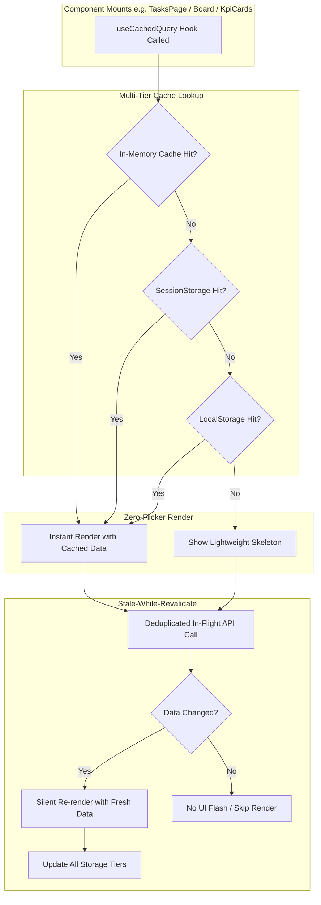
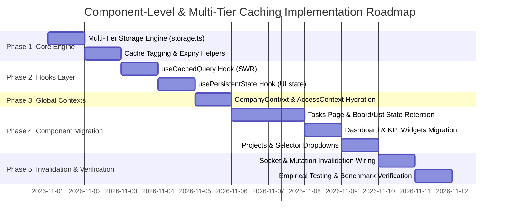

# Technical Requirements Document & Implementation Plan: Component-Level & Multi-Tier Caching Architecture

**Target Project:** Task-manager (`web/` Next.js 16 + React 19 Client Architecture)  
**Document Version:** 1.0.0  
**Status:** Architecture Specification & Implementation Roadmap (Review Mode — No code changes applied yet)

---

## 1. Executive Summary & Problem Analysis

### 1.1 The Current Problem
Currently, the Task-manager application suffers from noticeable latency, state loss, and visual flickering when users navigate between routes (e.g., from `/tasks` to `/dashboard` or `/projects` and back):
1. **Component-Level State Destruction:** When a user navigates to another page, Next.js client-side navigation unmounts the current page and its sub-components. Upon returning, component state (`useState`) re-initializes from scratch (`loading: true`, `data: null`), wiping filter rules, active views (Kanban vs. List), search terms, and scroll positions.
2. **Flash of Loading Spinners:** Even though some in-memory caching exists in `web/src/lib/cache.ts`, components unconditionality invoke `setLoading(true)` on mount inside `useEffect`. This displays full-page `<Loader2 />` spinners or empty skeleton boards for 200ms–800ms while waiting for microtasks or API promises to resolve, destroying the seamless feel of a modern single-page application.
3. **Storage Tier Misalignment:**
   - **Cookies:** Currently only sporadically store `active_company` without structured attributes or SSR hydration strategy.
   - **LocalStorage:** Only stores ad-hoc items like `lastCompany` and comment notification timestamps; does not cache reusable entity snapshots (current user, roles, permissions, projects).
   - **SessionStorage:** Completely unused across the entire web application, despite being the ideal mechanism for preserving tab/navigation state across route transitions.
   - **In-Memory Cache:** `cache.ts` uses a plain JavaScript `Map`, which is entirely wiped on hard reload (F5) or duplicate tabs, and does not provide synchronous data hydration to mounting components.

### 1.2 Target Vision
When a user navigates away from a page or component and comes back:
1. **Zero-Delay Rendering (0ms UI):** The component renders immediately using the cached snapshot from memory/session storage with **no loading spinners**.
2. **Stale-While-Revalidate (SWR):** A background fetch silently checks for newer data. If data changed, the component smoothly updates without jarring layout shifts.
3. **Preserved UI Experience:** Active filter tags, board groupings, open tabs, drawer states, and pagination survive route switches.
4. **Structured Multi-Tier Storage:** Clear boundary separation between **Cookies**, **LocalStorage**, **SessionStorage**, and **In-Memory Reactive Cache**.

---

## 2. Multi-Tier Storage Strategy Matrix

To prevent data corruption, quota overruns, and security leaks, each data type is mapped strictly to its appropriate storage tier:

| Storage Tier | Data Scope | Persistence / Lifecycle | Target Data & Use Cases | Max Size Budget | Invalidation Trigger |
| :--- | :--- | :--- | :--- | :--- | :--- |
| **Tier 1: Cookies** | Client & Server (SSR / Middleware) | Session or 30-day max | • Active tenant slug (`active_company`) • Theme preference (`theme`) • Auth session hints (secure/Lax) | < 4 KB | Tenant switch, user logout |
| **Tier 2: LocalStorage** | Browser-wide, cross-tab persistent | Long-term (persists across browser restarts) | • Current user profile snapshot (`/auth/me`) • Access control & permission matrices • Company list & metadata • Global UI settings (sidebar state, theme) | ~5 MB | User logout, permission version change (`policyVersion`), explicit tenant change, or 24h TTL |
| **Tier 3: SessionStorage** | Specific to current browser tab | Tab lifetime (survives route navigation & in-tab reloads) | • Component navigation states (active filters, search terms, groupBy mode) • Entity lists per company (tasks list snapshot, projects list) • Form draft states before submission • Modal/drawer active tab states | ~5 MB | Tab close, company switch, manual data mutation (POST/PUT/DELETE), or 15–30 min TTL |
| **Tier 4: In-Memory / Reactive Cache** | JavaScript heap (fastest access) | Runtime memory (reactive state) | • Active query cache (instant sync lookup for mounting components) • In-flight promise deduplication (prevents duplicate API requests) • Real-time WebSocket delta patches | Up to 100 entries | Mutating API calls, WebSocket push events, or TTL (1–5 min) |

---

## 3. Component-Level Caching Architecture

### 3.1 The Synchronous Hydration Principle
To prevent loading flashes on route transition, the component hook must provide the cached data **synchronously during the initial render**, rather than inside an asynchronous `useEffect`:
- `const { data, isLoading, isRefetching } = useCachedQuery(...)`
- If cached data exists in Memory or SessionStorage, `data` is immediately defined and `isLoading` is **`false`**.
- `isLoading` is `true` **only** when there is no data in any cache tier for that key.
- `isRefetching` indicates a silent background refresh, which can show a subtle micro-indicator (such as a slim progress bar or non-blocking pulse icon) without replacing the content with a spinner.

### 3.2 Dynamic Cache Keying by Tenant & Context
Because this is a multi-tenant platform, all cache keys must be namespace-scoped to prevent cross-company data leakage:
- Pattern: `tm:{companySlug}:{module}:{subKey}:{queryHash}`
- Examples:
  - `tm:acme:tasks:list:stage=all`
  - `tm:acme:dashboard:kpi:weekly`
  - `tm:acme:projects:all`
  - `tm:acme:ui:tasks_filter_state`

---

## 4. Technical Requirements Specification

### Functional Requirements (FR)
- **FR-1 (Instant Route Return):** Navigating from Page A to Page B and returning to Page A must restore Page A's components in < 16ms (within 1 frame), with zero layout jump and zero loading spinner.
- **FR-2 (Component Filter & View Persistence):** Component UI states (e.g., Kanban vs. List toggle, search input text, active filter chips, table sorting) must be preserved in SessionStorage and automatically restored when the user returns.
- **FR-3 (Multi-Tier Hierarchy):** Storage reads must waterfall: `Memory -> SessionStorage -> LocalStorage -> Network`. Storage writes must write back to all relevant tiers.
- **FR-4 (Coordinated Invalidation):** Any mutating HTTP request (POST/PATCH/DELETE) or WebSocket push event (`task:created`, `task:updated`, `project:updated`) must instantly invalidate matching tags across all storage tiers (Memory, Session, and Local).
- **FR-5 (Company Context Isolation):** Switching companies via the company switcher must wipe or segregate cache stores so data from Company A never leaks into Company B.
- **FR-6 (Safe Logout Cleanup):** Logging out must purge all sensitive user, access, and entity caches from LocalStorage and SessionStorage, leaving only non-sensitive preferences (e.g., theme).

### Non-Functional Requirements (NFR)
- **NFR-1 (SSR / Next.js Hydration Safety):** Accessing `window`, `localStorage`, or `sessionStorage` must never trigger Next.js hydration mismatch errors (`Text content does not match server-rendered HTML`).
- **NFR-2 (Storage Quota Guarding):** Session and Local storage items must include an automated pruning/TTL mechanism to stay well below browser storage limits (~5MB).
- **NFR-3 (Zero Additional Heavy Dependencies):** Utilize the existing modern foundation (`@tanstack/react-query`, Next.js 16, React 19, Axios) or lightweight targeted helpers without bloating package size.
- **NFR-4 (Developer Experience):** Abstract caching complexity into simple, reusable React hooks (`useCachedQuery`, `usePersistentState`) so standard components require only 2–3 lines of code change.

---

## 5. Target Components & Migration Scope

### 5.1 Global & Layout Contexts
1. **`CompanyContext` (`web/src/contexts/CompanyContext.tsx`):**
   - Initialize company details and user membership synchronously from Session/LocalStorage.
   - Eliminate initial blocking `loading: true` if an active cached company session exists.
2. **`AccessContext` (`web/src/contexts/AccessContext.tsx`):**
   - Cache compiled role permissions and `policyVersion` in LocalStorage.
   - Guarded pages render without delay if the cached permissions validate.

### 5.2 Primary Application Screens & Components
1. **Tasks Module (`/app/[companyId]/(main)/tasks`):**
   - **`TasksPage`:** Component-level caching for raw task lists.
   - **`usePersistentState`:** Retain `view` ('board' | 'list'), `filters`, `searchQuery`, and `groupBy` across page departures.
   - **Board & List Components:** Instant column/table rendering from cache.
2. **Dashboard Module (`/app/[companyId]/(main)/dashboard`):**
   - **`DashboardPage`:** Replace blocking `setLoading(true)` on `range` switch with stale-while-revalidate.
   - **`KpiCardsGrid` & Charts:** Render cached metrics instantly; execute silent background sync.
3. **Projects Module (`/app/[companyId]/(main)/projects`):**
   - Synchronous project list hydration from cache.
   - Persistent view filters (status, client, date).
4. **Common Reusable Components:**
   - **`ProjectsDropdown`:** Read from session cache with 0 API calls.
   - **`UserProfile` & `NotificationDropdown`:** Read unread counts and notifications from cached session.
   - **`EmployeeSelector`:** Cached employee list for assignees and team pickers.

---

## 6. Phased Implementation Plan

### Phase 1: Multi-Tier Storage Infrastructure (`storage.ts`)
- **Objectives:**
  1. Build a unified browser storage abstraction (`web/src/lib/storage.ts`) that safely handles:
     - SSR checks (`typeof window === 'undefined'`).
     - JSON serialization/deserialization with schema versioning.
     - TTL expiration checks.
     - Quota full (`QuotaExceededError`) safe fallback and LRU eviction.
  2. Implement unified Cookie helper for `active_company` and user preferences with `SameSite=Lax` and proper pathing.
  3. Extend `cache.ts` to seamlessly bridge in-memory cache with `sessionStorage` and `localStorage`.

### Phase 2: Reactive Component Hooks Layer
- **Objectives:**
  1. Create **`useCachedQuery<T>`**:
     - Synchronous initial state read (Memory -> SessionStorage -> LocalStorage).
     - Background stale-while-revalidate with promise deduplication.
     - Expose `{ data, isLoading, isRefetching, error, refetch }`.
  2. Create **`usePersistentState<T>`**:
     - Drop-in replacement for `useState` for component UI states (filters, active tabs, search queries, sort options).
     - Automatically synchronizes with `sessionStorage` so navigating back restores exact UI state.

### Phase 3: Contexts & Shared State Optimization
- **Objectives:**
  1. Update `CompanyContext` to initialize from cookie + session cache, eliminating the flash of "No Company Selected".
  2. Update `AccessContext` to initialize from stored permissions, preventing permission-gate flicker.
  3. Ensure company switching triggers `invalidateCompanyCaches(oldSlug)`.

### Phase 4: Component-by-Component Integration
- **Step 4A: Tasks Module**
  - Migrate `TasksPage` to `useCachedQuery('tasks', () => fetchTasks())`.
  - Migrate `view`, `filters`, `searchQuery`, `groupBy` to `usePersistentState`.
  - Validate: user sets filters, switches to `/dashboard`, switches back to `/tasks` -> tasks and filters remain instantly intact.
- **Step 4B: Dashboard Module**
  - Migrate `DashboardPage` and KPI charts to `useCachedQuery`.
  - Switch between weekly and monthly tabs with zero spinner flash.
- **Step 4C: Projects & Navigation Dropdowns**
  - Connect project lists and employee selectors to component cache so dropdown clicks open instantly without loading delays.

### Phase 5: Invalidation Coordination & Real-Time Sync
- **Objectives:**
  1. Synchronize Axios mutation interceptors: when a task/project/team is created, updated, or deleted, automatically purge the matching keys from memory, sessionStorage, and localStorage.
  2. Synchronize WebSocket events in `SocketContext`: on incoming realtime events (`task:updated`, etc.), update or invalidate the component cache without requiring a full page refresh.
  3. Ensure `clearCache()` on user logout thoroughly cleans up sensitive local and session entries.

### Phase 6: Edge Case Hardening & Empirical Verification
- **Validation Checklist:**
  - [ ] **Cross-Page Return Test:** Navigate Dashboard -> Tasks -> Projects -> Tasks. Measure time-to-first-render (target: < 16ms, 0 network requests, 0 spinners).
  - [ ] **Page Refresh Test:** Hard reload (F5) restores critical state without layout breakage.
  - [ ] **Multi-Company Switch Test:** Switching companies completely flushes previous company data.
  - [ ] **SSR Hydration Test:** Zero React hydration mismatch warnings in the browser console.
  - [ ] **Mutation Accuracy Test:** Creating/editing a task immediately updates the board and clears stale caches.

---

## 7. Next Steps & User Confirmation

> [!IMPORTANT]
> **No code has been modified yet.** This plan outlines the exact architectural blueprint, storage matrix, and phase breakdown.
> Once you review and approve this specification, we will proceed step-by-step with Phase 1.
